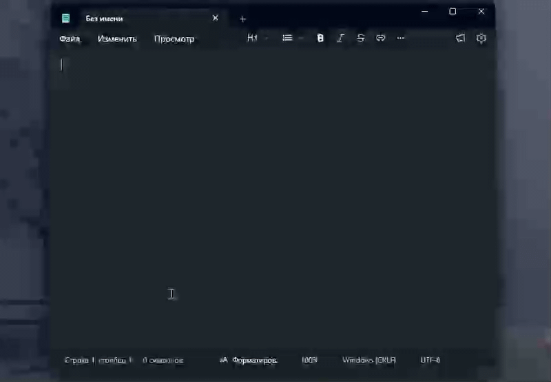

<center>
<p align="center">
  <h1>Russian - English Fixer</h1>
  <p>Небольшая Python-утилита для исправления текста, набранного в неправильной раскладке клавиатуры.</p>
</p>

---

## Об утилите

**Russian - English Fixer** — небольшая утилита, которая помогает исправлять текст, случайно набранный в неправильной раскладке клавиатуры.

Больше не нужно переписывать весь текст вручную!

Например:
| Было | Стало |
|---|---|
| `ghbdtn` | `привет` |
| `rfr ltkf` | `как дела` |
| `руддщ` | `hello` |

Программа преобразует ваш текст на другой язык по нажатию горячих клавиш.

## Возможности

- 🔄 Перевод текста из русской раскладки в английскую и обратно.
- 📋 Использование буфера обмена.

## Демонстрация

<p align="center">
  
</p>

## Зависимости

Утилита написана на **Python 3.14.0** с использованием следующих библиотек:

- [keyboard](https://pypi.org/project/keyboard/) — работа с клавиатурой.
- [PyAutoGUI](https://pypi.org/project/PyAutoGUI/) — автоматизация взаимодействия с клавиатурой.
- [pyperclip](https://pypi.org/project/pyperclip/) — работа с буфером обмена.

## Установка

**1. Клонируйте репозиторий:**

```bash
git clone https://github.com/qualzed/ru-en-fixer.git
```

**2. Перейдите в папку проекта:**

```bash
cd ru-en-fixer
```

**3. Установите зависимости:**

```bash
pip install -r requirements.txt
```

**4. Запустите программу:**

```bash
python main.py
```

## Использование

1. Запустите программу.
2. Введите текст в неправильной раскладке.
3. Используйте горячие клавишы которые указаны, либо указали вы в <b>config.json</b>
4. Получите текст с правильной раскладкой.